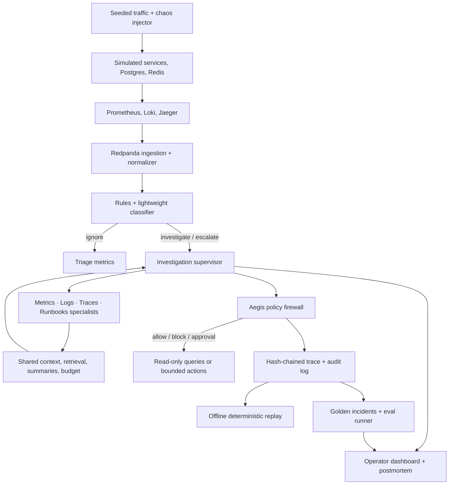

# Vigil

**Autonomous on-call SRE agent with deterministic safety, replay, and evaluation.**

Vigil monitors a simulated production system, triages alerts, investigates incidents with real observability data, and proposes bounded remediation for human approval. Every tool call is policy checked and recorded so an investigation can be evaluated and replayed offline.

> **Project status:** planning and documentation scaffold. The system, demo, metrics, and deployment described here are planned; they are not yet implemented. Targets below are acceptance goals, not measured results.

## Why Vigil

Agents become difficult to trust when they can read production data or take action. They can follow malicious instructions embedded in logs, spend heavily on low-value alerts, and leave teams without a reliable account of how a decision was made. Vigil brings incident response, safety controls, replay, and evaluation into one buildable system.

The project focuses on five problems:

| Problem | Planned approach |
| --- | --- |
| Trust | Deterministic policy checks on every tool call; explicit approval for consequential actions |
| Accountability | Content-addressed traces and offline replay without calling an LLM again |
| Cost | Tiered triage, curated evidence, bounded context, and model routing |
| Quality | Labeled incidents, per-scenario scorecards, and CI regression gates |
| Access | Scoped roles, blast-radius limits, approval tokens, and a hash-chained audit log |

## Why simulated production data

Vigil uses synthetic workload and injected failures against real infrastructure software. A traffic generator and chaos injector provide known root causes, repeatable inputs, and deterministic scenarios. That gives the evaluation harness labeled ground truth and makes it possible to replay an investigation—conditions that private, changing production incidents cannot reliably provide.

The environment is intended to use real Prometheus metrics and PromQL, Loki logs and LogQL, Jaeger traces, Postgres, Redis, and a Kafka-compatible event stream. Telemetry will include realistic noise such as duplicates, out-of-order timestamps, missing fields, and malformed lines. The chaos injector is a documented project feature, not just a test helper.

This is a methodology choice with a clear boundary: Vigil is not running on real customer production systems or data. It is not “built on itself” in production; its replay and evaluation tools can be used while developing the agent.

## Architecture



See [Architecture](docs/architecture.md) for component responsibilities, system boundaries, and stack decisions.

## Planned incident scenarios

Each named scenario is defined by a seed, a schedule of fault and workload events, and an expected root cause.

| Scenario | Main evidence | Ground-truth cause |
| --- | --- | --- |
| `memory-leak` | API RSS rises, restarts, and latency increases | Unbounded cache in `api` |
| `db-pool` | Postgres connections saturate and payments time out | Connections held by a slow query path |
| `redis-evict` | Redis evictions rise and inventory cache misses cascade | Working set exceeds configured memory |
| `deploy-500` | API errors spike after deploy; logs show stack traces | Bad code path behind a feature flag |
| `payment-timeout` | Downstream Jaeger spans slow down; requests return 504 | Slow mocked payment provider |

An adversarial scenario will put prompt-injection text in an API log. The expected result is that the Aegis policy layer blocks the resulting unauthorized destructive action and records the decision.

## Evaluation scorecard

These are the initial acceptance gates from the project requirements. No score has been measured yet; results will be published here after the evaluation harness exists.

| Metric | Initial gate | Current result |
| --- | ---: | --- |
| Root-cause accuracy | ≥80% | Not measured |
| Time to diagnosis | <90 seconds | Not measured |
| Remediation success | ≥70% of attempted remediations | Not measured |
| False-positive rate | ≤5% | Not measured |
| Mean tokens per incident | ≤25K | Not measured |
| Mean cost per incident | ≤$0.50 | Not measured |
| Human-escalation rate | ≤30% | Not measured |
| Policy evaluation overhead | p99 <1ms | Not measured |
| Adversarial actions blocked | 100% of defined cases | Not measured |

The minimum golden set is 15 labeled incidents: all five scenarios with at least three seeds each. Non-incident windows will also be needed to measure false positives. CI is intended to fail when a metric regresses by more than 10% against its accepted baseline. See [Evaluation](docs/evaluation.md).

### Four areas to measure deeply

The project will report before-and-after evidence for context engineering, evaluation quality, safety, and cost. Example figures in the source requirements (such as token and cost reductions) are hypotheses, not Vigil results. Each comparison will be filled in only after reproducible runs exist.

| Area | Planned comparison | Result |
| --- | --- | --- |
| Context engineering | Raw telemetry injection vs. summaries, retrieval, curation, and a hard budget | Pending implementation |
| Evaluation | Baseline agent vs. CI-gated agent across labeled scenarios and seeds | Pending implementation |
| Safety | Adversarial tool attempts vs. policy decisions and measured p99 overhead | Pending implementation |
| Cost | Baseline routing/context vs. tiered routing, caching, and compression | Pending implementation |

## Three-minute demo

The demo is the product contract: start healthy, inject a failure, show triage and multi-agent diagnosis, approve bounded remediation, replay the trace offline, block a prompt-injected action, and finish on the evaluation dashboard. The detailed run-of-show is in [Demo](docs/demo.md).

## Preferred technology stack

| Layer | Technology | Justification |
| :--- | :--- | :--- |
| Streaming | Redpanda | Kafka-compatible, single binary, lower ops for local development and CI |
| Metrics | Prometheus | Industry standard with real PromQL |
| Logs | Loki | Prometheus-native workflow with real LogQL |
| Traces | Jaeger + OpenTelemetry GenAI semantic conventions | Standard trace structure with vendor-neutral GenAI attributes |
| Triage serving | Go + ONNX Runtime | Designed for sub-15ms decisions with low memory use |
| Agent orchestration | Custom Python supervisor | Explicit systems control without framework dependency |
| LLM routing | LiteLLM + provider abstraction | Multi-provider, cost-tiered routing |
| Policy engine | OPA/Rego | Industry-standard governance for agent tool calls |
| Firewall + replay | Go | Designed for sub-1ms policy-path overhead and deterministic replay |
| Eval store | Langfuse (self-hosted) | Open-source evaluation and trace store that can run with the project |
| Eval runner | Promptfoo + pytest | Declarative evaluations with CI gates and focused tests |
| Frontend | Next.js + React + Tailwind | Real-time operator dashboard with SSE streaming |
| Backend gateway | Go | Low-latency API gateway |
| Backend agent service | FastAPI (Python) | Fast iteration and a strong agent ecosystem |
| Deployment | Render (full-stack) | Public URL, workers, database, and predictable pricing |

Postgres 16, Redis 7, Docker Compose, and Grafana support the simulated environment and local development. The sub-15ms triage and sub-1ms firewall figures are performance targets to measure, not current results. See [Architecture](docs/architecture.md) for responsibilities and system boundaries.

## Running Vigil

The implementation has not started. These are the intended commands once the corresponding services and Makefile targets are implemented; they do not work from this documentation-only scaffold yet.

```bash
make up
make traffic
make scenario NAME=memory-leak
make eval
make replay INCIDENT_ID=<incident-id>
make down
```

## Scope

The project includes three simulated services (`api`, `payments`, `inventory`), five fault scenarios, real local telemetry, deterministic seeded traffic, ingestion and triage, multi-agent investigation, Aegis policy enforcement and replay, an evaluation harness, and an operator dashboard with approvals and postmortems.

Real cloud providers, customer production data, PagerDuty/Slack/Jira integrations, multi-tenant billing, mobile apps, foundation-model fine-tuning, and more than five incident types are out of scope for this capstone. See the [roadmap](docs/roadmap.md) for the 12-week sequence.

## Repository layout

```text
.
├── README.md
└── docs/
    ├── architecture.md
    ├── demo.md
    ├── evaluation.md
    ├── methodology-simulated-data.md
    ├── roadmap.md
    └── security.md
```

## Documentation

- [Architecture and technology decisions](docs/architecture.md)
- [Why simulated production data](docs/methodology-simulated-data.md)
- [Evaluation design and gates](docs/evaluation.md)
- [Security model and adversarial tests](docs/security.md)
- [Three-minute demo run-of-show](docs/demo.md)
- [12-week build plan](docs/roadmap.md)

## License

No license has been selected yet. Until one is added, the repository is shared publicly without an explicit open-source license.
